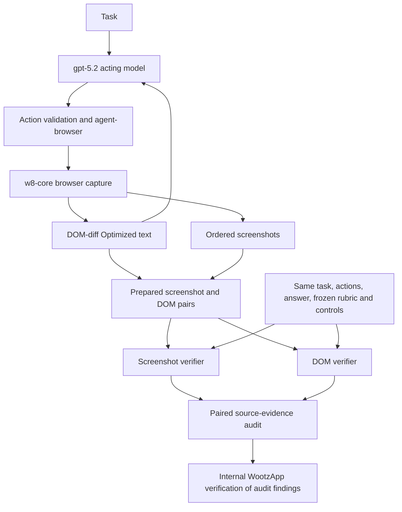

---
configs:
- config_name: default
  data_files:
  - split: train
    path: tasks.jsonl
license: apache-2.0
---

# Dataset Card

## Contents

The dataset contains 100 paired browser-task trajectories. Each pair
uses the same task, executed action history, and final answer. One side stores
screenshots; the other stores model-facing DOM text. The primary data is in
`trajectories/data-ss/` and `trajectories/data-dom/`, each containing 100 task
folders (`task_01` through `task_100`).

## Repository guide

| Path | Contents |
|---|---|
| [`trajectories/data-ss/`](trajectories/data-ss/) | Primary screenshot trajectories: task metadata, final answers, action logs, and ordered screenshots. |
| [`trajectories/data-dom/`](trajectories/data-dom/) | Paired DOM-text trajectories: task metadata, final answers, action logs, and ordered model-facing DOM observations. |
| [`tasks.jsonl`](tasks.jsonl) | Catalog of 100 tasks with identifiers, categories, instructions, start URLs, stopping conditions, and constraints. The dataset loader configuration above exposes this file as the `train` split; trajectory artifacts are stored separately in the repository. |
| [`recordings/`](recordings/) | Additional browser-run artifacts for inspecting collection, including manifests, model decisions, executed actions, and captured browser states. See [RECORDINGS.md](RECORDINGS.md) for the artifact layout and capture policy. |
| [`evaluation/`](evaluation/) | Saved verifier comparisons and automated evidence audits, including frozen rubrics, results, run provenance, and per-task Markdown reports. |
| [EVALUATIONS.md](EVALUATIONS.md) | Aggregate evidence-audit findings, methodology, model provenance, and limitations. |
| [EVIDENCE-CATEGORIES.md](EVIDENCE-CATEGORIES.md) | Definitions, boundary rules, audited examples, and counting conventions for the six source-evidence-loss categories. |

Start with the paired trajectory folders for the prepared data. The recordings
and evaluation artifacts provide supporting collection and audit detail.

## Collection

Tasks were executed in w8-core through agent-browser. The recorder captured an
initial state and one state after every executed action. The acting model used
DOM-based observations. Screenshots were stored as evaluation artifacts and
were not sent to the acting model.

## Foundations and attribution

WebVoyager introduced multimodal automatic evaluation for open-ended web
tasks [[1]](#references). The screenshot baseline follows the Universal
Verifier's rubric-centered design: criterion-specific evidence selection,
separate process and outcome judgments, and failure attribution
[[2]](#references). WootzApp adds the DOM-based adaptation, browser-native
evidence capture, paired comparison protocol, and source-aware audit.

WebArena provides screenshot, HTML DOM, and accessibility-tree observations
and evaluates functional task completion in controlled websites
[[4]](#references). These systems provide context for structured and visual
browser evidence. This benchmark measures what paired recorded
representations preserve under a shared rubric; it does not reproduce those
benchmarks' task-success experiments.

## Project architecture

`w8-core` captures browser states, DOM-diff Optimized renders compact
structured observations, and `w8-domdiff-bench` compares those observations
with screenshots from the same trajectory. The recorder connects model
decisions to executed actions; the paired verifiers evaluate the prepared
evidence against one frozen rubric, followed by a source-evidence audit.

Raw recordings and prepared verifier inputs have separate file contracts.
This dataset publishes both, with screenshots and DOM text aligned by action
step in the prepared pairs. The architecture below follows the upstream
[architecture guide](https://github.com/wootzapp/w8-domdiff-bench/blob/w8-reproducible/docs/architecture.md);
the implementation lives in that project, while this repository holds the data
and saved evaluation artifacts.

| Component | Role | Evidence and current status | How to inspect | Files or controls |
| --- | --- | --- | --- | --- |
| Browser capture | Captures screenshots and structured page state in `w8-core`. | Initial state and states after executed actions are indexed in each recording manifest. | Follow the manifest's state and action references. | [`recordings/`](recordings/) · upstream `w8bench/task_recorder/` and `protocol/ChromiumRL.pdl` |
| Action harness | Validates model proposals and executes actions through `agent-browser` in the same tab. | Rejected proposals and executed actions have separate records. | Compare `decisions.jsonl`, `trajectory.jsonl`, and state transitions. | [Recording guide](RECORDINGS.md) |
| DOM-diff Optimized | Renders each captured state as compact structured text. | Preserves content, controls, tables, relationships, and scroll context within capture limits. | Compare `dom_model.txt` with detailed capture and screenshots. | Upstream `w8bench/task_recorder/renderers/` |
| Prepared pairs | Aligns screenshots and DOM text by action step. | Both sides share task inputs, executed actions, and final answer. | Compare metadata, action logs, and numbered evidence states. | [`trajectories/data-ss/`](trajectories/data-ss/) · [`trajectories/data-dom/`](trajectories/data-dom/) |
| Paired verifiers | Scores both representations against the same frozen rubric and controls. | Screenshot and DOM loaders supply different evidence under the shared protocol. | Inspect rubric hashes, results, and saved run provenance. | [`evaluation/`](evaluation/) · upstream `w8bench/screenshot_verifier/` and `w8bench/dom_model/` |
| Evidence audit | Separates missing source evidence from verifier interpretation errors. | The upstream report attributes audit/adjudication to `gpt-5.6-sol` and verification of those findings to internal WootzApp employees. | Inspect `evidence_audit.json` and its source citations. | [Evaluation findings](EVALUATIONS.md) · upstream `w8bench/verifier/` |

The acting model receives compact page text, interactive control references,
task memory, and recent action outcomes. Screenshots are retained for
inspection and screenshot-based verification. Chromium node identifiers and
executable `agent-browser` references belong to separate namespaces. The
benchmark uses `gpt-5.2` for action generation, rubric generation, and evidence
judgments; `o4-mini` for action/validity judgments; and `gpt-5.6-sol` for
evidence audit/adjudication. Saved provenance identifies each evaluation's
actual models and controls.

The representation evolved from detailed DOM capture, through before/after
DOM diffs, to DOM-diff Optimized: self-contained descriptions of individual
states that do not require a separate diff file. Browser-native processing
selects and groups captured content, with refinements for nested text,
contextual deduplication, author labels, control states, and visibility after
scrolling. A former 500-character subtree-text limit was removed. These are
engineering stages, not an ablation of their individual effects.

The model-facing `dom_model.txt` observations average **5.87 KiB** per
captured state in the evaluated collection.

Recorded manifests and prepared pairs establish the capture and alignment
contracts; alignment checks alone do not establish answer correctness or
faithful live replay. DOM, screenshots, and action-tool observations are
captured sequentially and can diverge on changing pages. Viewport filtering
and capture limits mean that even a detailed snapshot may omit offscreen,
cross-origin, or shadow-DOM content. Visual appearance, geometry, image
content, canvas, and video can require screenshots or additional capture
support. DOM can lose relationships, control states, or rendered notation.
These boundaries are not resolved by the paired evidence-loss metric.

## Trajectory files

Each task folder contains:

- `task_data.json`: task text and start URL.
- `final_answer.json`: recorded answer and exported outcome metadata
- `web_surfer.log`: one normalized row per executed action
- `screenshotN.png`: ordered screenshot state
- `dom_modelN.txt`: ordered DOM-model state (DOM trajectories only)

`screenshotN.png` is present in screenshot trajectories only. State 0 is the
initial captured state; subsequent numbered states follow executed actions.
Raw recordings start at `steps/step_001/`; a raw state's `action.json` describes
the action leading to the next state. Rejected model proposals do not create
executed-action entries.

## Benchmark protocol and mathematical definitions

The formulas below follow the upstream [technical report](https://github.com/wootzapp/w8-domdiff-bench/blob/w8-reproducible/docs/technical-report.md#benchmark-protocol-and-mathematical-definitions).

The evaluation contains one paired trajectory for each of 100 tasks and **642 audited rubric criteria** [[3]](#references). Screenshots and DOM states are aligned by action step, and both verifiers receive the same task inputs, executed actions, final answer, frozen rubric, and scoring controls. An execution with N actions normally yields N + 1 recorded states: the initial state and one state after each executed action.

### Rubric scores and task-success rules

For task t, let st,j be the final awarded points for rubric criterion j, after the verifier's scoring and rescoring stages, and let pt,j be its maximum points. The earned total, maximum total, and normalized rubric score are:

$$
S_t=\sum_j s_{t,j},
\qquad
S_t^{\max}=\sum_j p_{t,j},
\qquad
r_t=\frac{S_t}{S_t^{\max}}\quad(S_t^{\max}>0).
$$

The implementation sets the normalized score to zero when the maximum total is zero. For a valid rubric with a positive maximum total, a **strict full-score success** means earning every available point:

$$
\mathrm{Success}_{\mathrm{full}}(t)
=\mathbf{1}\{S_t=S_t^{\max}\}.
$$

This defines the full-credit convention (x/x). The verifiers also distinguish process and outcome rules. Let Pt be the process pass flag at rubric threshold τ, and let Ot indicate that the outcome judge returned the Boolean `true`:

$$
P_t=\mathbf{1}\{r_t\ge\tau\},
\qquad
O_t=\mathbf{1}\{\texttt{output\_success}_t=\mathrm{true}\}.
$$

The three binary success rules are:

$$
\mathrm{Success}_{\mathrm{outcome}}(t)=O_t,
\qquad
\mathrm{Success}_{\mathrm{process}}(t)=P_t,
\qquad
\mathrm{Success}_{\mathrm{both}}(t)=P_t O_t.
$$

The paired evaluation uses the **outcome rule** and **τ = 0.8**, so its binary `score` follows the outcome judgment; `rubric_is_success` separately records whether at least 80% of rubric points were earned. A strict full-score summary uses the first rule above. The standalone verifiers support all three rules. These definitions apply separately to each representation of a task.

The [shared controls](https://github.com/wootzapp/w8-domdiff-bench/blob/w8-reproducible/w8bench/verifier/common.py) also fix five evidence items per criterion, a screenshot keypoint threshold of 3, a minimum relevance threshold of 0, and one voting instance. The [screenshot runner](https://github.com/wootzapp/w8-domdiff-bench/blob/w8-reproducible/w8bench/screenshot_verifier/runner.py) and [DOM runner](https://github.com/wootzapp/w8-domdiff-bench/blob/w8-reproducible/w8bench/dom_model/runner.py) implement the binary rules. The [evaluation protocol](https://github.com/wootzapp/w8-domdiff-bench/blob/w8-reproducible/docs/evaluation-protocol.md#success-rules) summarizes them, while saved run manifests establish the controls used by a particular evaluation. None of these success rules defines source-evidence loss.

### Paired source-evidence loss

Let 𝒞 be the audited rubric criteria, M = |𝒞|, and ℐc the concrete required values or states reviewed for criterion c. For required item i ∈ ℐc, let ac,i,S, ac,i,D ∈ {0, 1} indicate its availability in screenshots (S) and DOM-diff Optimized (D), respectively, across the eligible ordered source states. Both representations use the same evidence requirements and review scope.

$$
\ell_{c,S}=\mathbf{1}\!\left\{\exists i\in\mathcal{I}_c:
a_{c,i,S}=0\ \land\ a_{c,i,D}=1\right\},
\qquad
\ell_{c,D}=\mathbf{1}\!\left\{\exists i\in\mathcal{I}_c:
a_{c,i,D}=0\ \land\ a_{c,i,S}=1\right\}.
$$

Each indicator is binary: a criterion contributes at most one loss per representation, even if several required items are missing. Partial preservation still counts as loss when one specific required item is absent from that representation and present in the other. Items available in both or absent from both do not trigger paired loss. Evidence that a verifier overlooks or misinterprets is an interpretation error, separate from source availability.

For representation m, the loss count and percentage rate are:

$$
L_m=\sum_{c\in\mathcal{C}}\ell_{c,m},
\qquad
\mathrm{ELR}_m=\frac{100L_m}{M},
\qquad m\in\{S,D\}.
$$

All audited criteria remain in the denominator, including those without a gap. A criterion can lose different items in both representations, contributing to both marginal counts. Multiple criteria can depend on one capture omission. This metric measures differences between paired recorded sources; information omitted from both sources remains undetected.

### Current counts and relative reduction

The reported evaluation findings give:

$$
M=642,
\qquad
L_S=\sum_{c\in\mathcal{C}}\ell_{c,S}=151,
\qquad
L_D=\sum_{c\in\mathcal{C}}\ell_{c,D}=5.
$$

Therefore,

$$
\mathrm{ELR}_S=\frac{151}{642}\times100\approx23.52\%,
\qquad
\mathrm{ELR}_D=\frac{5}{642}\times100\approx0.78\%.
$$

For a shared denominator and LS > 0, the relative reduction is:

$$
\mathrm{Relative\ reduction}
=\frac{\mathrm{ELR}_S-\mathrm{ELR}_D}{\mathrm{ELR}_S}\times100
=\frac{L_S-L_D}{L_S}\times100
=\frac{151-5}{151}\times100
\approx96.7\%.
$$

Excluding primary URL-category losses retains all 642 criteria and gives:

$$
L_S^{\mathrm{nonURL}}=151-117=34,
\qquad
L_D^{\mathrm{nonURL}}=5-0=5,
$$

$$
\mathrm{ELR}_S^{\mathrm{nonURL}}=\frac{34}{642}\times100\approx5.30\%,
\qquad
\mathrm{ELR}_D^{\mathrm{nonURL}}=\frac{5}{642}\times100\approx0.78\%,
$$

$$
\mathrm{Relative\ reduction}_{\mathrm{nonURL}}
=\frac{34-5}{34}\times100
\approx85.3\%.
$$

These are relative reductions in criterion-level source-loss counts. Task-success rates, verifier accuracy, and acting-agent improvement require their own measurements. The [URL sensitivity analysis](EVALUATIONS.md#url-sensitivity-and-paired-comparison) explains the identity rule, overlapping findings, and alternatives that remove entire criteria.

## Evaluation results and graphs

The 100-task comparison covers **642 audited rubric criteria**, with
**151 screenshot losses and 5 DOM losses**. The upstream report describes
model-generated audit/adjudication findings verified by internal WootzApp
employees. These counts measure paired source-evidence availability;
task success, answer correctness, and acting-agent improvement require
separate measurements. [EVALUATIONS.md](EVALUATIONS.md) contains the saved
findings, source citations, paired outcomes, and further sensitivity analyses.

| Analysis | Tasks | Audited criteria | Screenshot losses | DOM losses |
| --- | ---: | ---: | ---: | ---: |
| All source-evidence loss categories | 100 | 642 | **151 (23.52%)** | **5 (0.78%)** |
| URL loss category excluded | 100 | 642 | **34 (5.30%)** | **5 (0.78%)** |
| Listed access-blocked task IDs excluded | 88 | 575 | **125 (21.74%)** | **5 (0.87%)** |
| Listed access-blocked task IDs and URL loss category excluded | 88 | 575 | **32 (5.57%)** | **5 (0.87%)** |

**Figure 1.** Evidence-loss rates for the full dataset and the subset excluding
the 12 listed blocked task IDs, each with and without the URL loss category.
URL exclusions retain all criteria within each cohort. The exploratory 95%
Wilson intervals assume independent criteria and do not adjust for correlation
within tasks or annotation error.

### URL sensitivity and category counts

The screenshot capture mechanism omits the browser's address bar. URLs account
for **117 of the 151 screenshot losses (77.5%)** and **0 of the 5 DOM losses**.
A missing URL counts only when the rubric requires exact website, page,
record, or endpoint identity and DOM preserves the required URL. Under the
saved audit's identity rule, visible branding and URLs in the shared action
history do not replace URL evidence within the representation itself.

Excluding the primary URL loss category removes those findings from the
numerator while keeping all criteria in the cohort. It recalculates existing
findings; it does not estimate what would happen if URLs were added to
screenshots or the rubric were changed. Removing entire criteria with URL
findings is a different analysis, documented in
[the sensitivity analysis](EVALUATIONS.md#alternative-exclude-entire-criteria-with-url-findings).

**Figure 2.** Non-URL losses by category, using the same count scale for both
cohorts. Each bar counts representation/criterion losses; each affected
representation receives one primary category. Both panels retain all audited
criteria within their cohort. The URL category is omitted to keep the smaller
category counts readable. See [category definitions](EVIDENCE-CATEGORIES.md).

The full comparison contains **154 distinct affected criteria across 91
tasks**. Two criteria lose different required items in both representations,
so they contribute to both the 151 screenshot and 5 DOM counts. The counts
cannot be added to obtain the number of distinct affected criteria. Several
criteria can also depend on a single capture omission.

### Excluding listed access-blocked tasks

The exclusion set contains `task_01`, `task_06`, `task_07`, `task_10`,
`task_14`, `task_15`, `task_20`, `task_22`, `task_23`, `task_46`, `task_53`,
and `task_58`. Excluding their 67 criteria leaves **88 tasks and 575 criteria**,
removing 26 screenshot losses (24 URL losses and 2 exact-text-and-value losses)
and no DOM losses. These task IDs come from the
[documented blocker examples](EVALUATIONS.md#website-access-blockers-and-unavailable-content);
excluding them does not establish that every remaining run was free of access
blockers. A website access blocker and a source-evidence gap can occur in the
same task.

**Figure 3.** Screenshot losses fall from 151 to 125 to 32, while DOM losses
remain at 5. Excluding the listed task IDs changes the denominator from 642
to 575 criteria; excluding the remaining 93 URL losses keeps all 575 criteria.
Hatched bars show the loss counts excluded at each step.

## Limits

The tasks reflect public web pages at their recording time. Sites can change,
block automation, require login, or return different content later. The data
can contain text that was publicly visible on those pages. Users should review
task content before redistributing subsets or using them for training.

Successful, failed, and errored runs are retained in the recordings. Recorded
outcomes describe collection status; automated evaluation and evidence-audit
judgments are separate artifacts. Neither constitutes manually verified answer
correctness.

Recordings and evaluations can refer to different run versions. Check task
identifiers, timestamps, and saved provenance before treating a recording or
evaluation as corresponding to a particular published trajectory.

## References

\[1\] Hongliang He, Wenlin Yao, Kaixin Ma, Wenhao Yu, Yong Dai, Hongming Zhang, Zhenzhong Lan, and Dong Yu. [WebVoyager: Building an End-to-End Web Agent with Large Multimodal Models](https://arxiv.org/abs/2401.13919). *arXiv:2401.13919*, 2024. doi: 10.48550/arXiv.2401.13919.

\[2\] Corby Rosset, Pratyusha Sharma, Andrew Zhao, Miguel Gonzalez-Fernandez, and Ahmed Awadallah. [The Art of Building Verifiers for Computer Use Agents](https://arxiv.org/abs/2604.06240). *arXiv:2604.06240*, 2026. doi: 10.48550/arXiv.2604.06240. [Official code and data](https://github.com/microsoft/fara).

\[3\] WootzApp. [w8-domdiff-bench benchmark data and criterion-level audit records](https://huggingface.co/datasets/WootzappLab/browser-agent-tasks), 2026. Evaluation: 100 tasks, 642 audited criteria. [Machine-readable summary](https://github.com/wootzapp/w8-domdiff-bench/blob/w8-reproducible/results/summary.json) and [results index](https://github.com/wootzapp/w8-domdiff-bench/blob/w8-reproducible/results/README.md).

\[4\] Shuyan Zhou, Frank F. Xu, Hao Zhu, Xuhui Zhou, Robert Lo, Abishek Sridhar, Xianyi Cheng, Tianyue Ou, Yonatan Bisk, Daniel Fried, Uri Alon, and Graham Neubig. [WebArena: A Realistic Web Environment for Building Autonomous Agents](https://arxiv.org/abs/2307.13854). *arXiv:2307.13854*, 2023. doi: 10.48550/arXiv.2307.13854.
