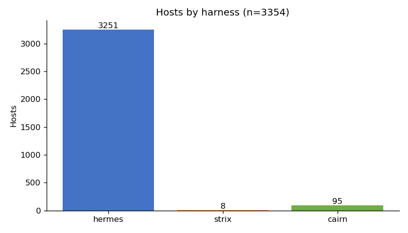
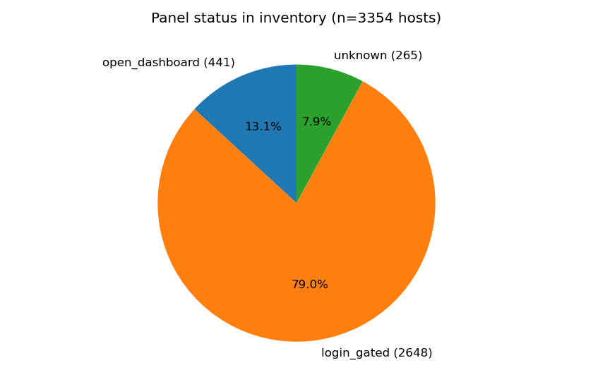
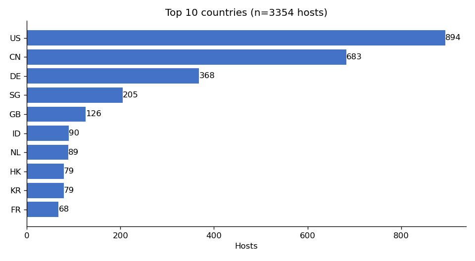
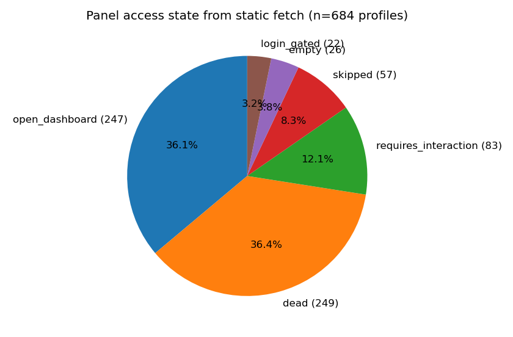
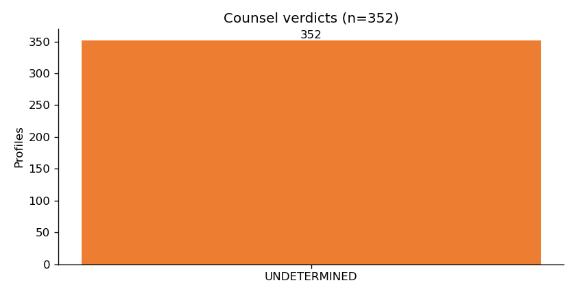

# Cairn / Strix / Hermes panel hunt — final report

- Date of work: 2026-10-19
- Lane: `cairn-panels`
- Source files: `data/lanes/cairn-panels/working/` and `data/lanes/cairn-panels/raw/`
- Style: ASD-STE100. Terms are defined on first use.

## Terms

- **Harness**: the agent software that ran the agent. The three harnesses here are Cairn, Strix, and Hermes Agent.
- **Panel**: the web dashboard of a harness. Operators use it to run agents.
- **Banner**: one Shodan scan record of one open port. Shodan is a search engine for internet devices. One host can have many banners.
- **Host**: one IP address.
- **SPA**: single-page app. The page loads as an empty shell. Data arrives later through API calls.
- **Open dashboard**: a panel page we could load with no login.
- **Login-gated**: a panel page that asks for a login. We did not try to log in.
- **Dead**: the host did not answer, or the port was not a web port.
- **Counsel**: the review pass in this hunt. It graded each panel profile.
- **Gate closed**: Counsel stopped. The evidence cannot support a better verdict. No more review on this evidence.
- **CSP nonce**: a one-time code in the page. It lets only the page's own scripts run.

## Executive summary

### What we did

We used the Shodan API to find exposed panels for three agent harnesses: Cairn, Strix, and Hermes Agent. Then we fetched 684 panel pages with plain GET requests. We started no sessions. We did no logins. We sent no POST requests.

### What we found

- **3,354 hosts** carry one of the three harnesses. Hermes: 3,251. Cairn: 95. Strix: 8. No host carries two harnesses.
- **441 hosts show an open dashboard** in the banner data. Our live fetch confirmed 247 open dashboards.
- One Cairn login host (**47.97.206.32**, Aliyun, China) also runs **Cobalt Strike C2** on port 50050. Cobalt Strike is an attack tool. This is co-location on one host, not proof the panel runs attacks.
- One open **Cairn coordinator** (**46.4.115.187:8443**, Hetzner, Germany) shows a **host-enrollment flow**. It tells the operator to mint a token, then run a curl-piped-to-shell install command on the target host. This is the most important single panel in the set.
- Counsel graded 352 profiles. **All 352 are UNDETERMINED.** The gate is closed. Static HTML cannot say more.
- 23 fetched pages were not panels at all: a French landing-page farm, a security-company site, and a Wix business page. They matched by name only.

### What we did NOT find

- No operator names or identities. We did not look for them.
- No targets, no tasking, no operator notes. The open dashboards load their data through APIs we did not call.
- No credentials. None appeared in any page we fetched.
- No proof that any open panel is running attacks. An open panel is not proof of crime. Red teams also expose panels.

## Method

1. **Shodan queries.** We refined one query per harness. The queries are in `working/refined-queries.json`. Shodan returned banners. We kept every banner as-is. We redacted nothing.
2. **Banner dedup.** Banners became hosts. 3,354 unique hosts. We pulled full host records for 54 of them. Shodan's API credit ran out before the rest.
3. **Passive fetch.** We fetched 684 panel URLs with curl. GET only. One pass. No login, no POST, no interaction. 379 pages saved as HTML with sha256 sidecars. 249 hosts were dead on fetch. 57 ports were not web ports. 83 pages needed interaction to read.
4. **Profile.** Each fetched page got a profile: title, access state, languages, API paths, notes.
5. **Babel pass.** 247 open dashboards got a language pass. It found page text in English, French, and Chinese.
6. **Cipher pass.** 155 findings. These are external URLs, encoded blobs, hidden API paths, and obfuscated scripts in the pages.
7. **Counsel pass.** 352 profiles got a verdict. All UNDETERMINED. Gate closed.

### Limits we do not hide

- The `product:"Hermes Agent"` banner set is **partial**: 4,200 of 5,499 banners. Shodan stopped returning pages past ~page 41. Credits ran out mid-retry. About 1,300 banners are unseen.
- Full host records exist for only 54 of 3,354 hosts.
- The AS56594 cluster had 14 panels in the NorForge report. Shodan now shows 1 banner. Panels go dark fast.
- Counts move. Shodan re-scans. A count of 97 today can be 90 or 110 tomorrow.

## Findings

### Inventory

| Harness | Hosts | Open dashboard | Login-gated | Unknown |
|---|---|---|---|---|
| Hermes | 3,251 | 340 | 2,646 | 265 |
| Cairn | 95 | 93 | 2 | 0 |
| Strix | 8 | 8 | 0 | 0 |
| **Total** | **3,354** | **441** | **2,648** | **265** |

**Hermes.** 3,251 hosts. Default port is 9119: 243 open dashboards sit on it, 99 on operator-chosen ports. The product fingerprint fires on renamed and localized builds: "Sign in — ATUM Sovereign", "Sign in — Meccano Agent", "Hermix Agent", Chinese, Korean, and Russian titles. Top countries: US 858, CN 672, DE 362, SG 203, GB 121. Top ASNs: AS45090 Tencent (367), AS31898 Oracle (308), AS24940 Hetzner (228), AS132203 Tencent (203), AS51167 Contabo (187). This is cheap-cloud concentration. No bulletproof-hosting ASN dominates.

**Cairn.** 95 hosts. 46 run uvicorn (the harness web stack). 44 sit on port 8000. Two are login-gated: 47.97.206.32 (Aliyun CN, port 8000) and 71.185.26.179 (Verizon US, port 443). Top countries: US 34, CN 10, FR 7, NL 6, DE 6. Top ASNs: AS56971 CGI GLOBAL LIMITED (11), AS16509 Amazon (7), AS20473 Vultr/Constant (7), AS132203 Tencent (4), AS24940 Hetzner (4), AS14061 DigitalOcean (4). Four hosts sit in IR on AS56971. Two show wide-open port sprawl (3306, 4444, 1433, 143, 1723, 5900) plus `database` and `open-dir` Shodan tags.

**Strix.** 8 hosts, all with the dashboard title visible. Ports 8080/7777/80/8533/8888. Countries: US 2, NL 2, GB 1, CN 1, CH 1, FI 1. Host records show high Shodan vuln counts (13–20, mostly old OpenSSH).

### Co-locations

- **47.97.206.32** (Aliyun CN): port 8000 = `Cairn - Login` on uvicorn. Port 50050 = Cobalt Strike C2 (Shodan product fingerprint; host tagged `c2`). Port 22 = OpenSSH. Full record: `raw/hosts/47.97.206.32.json`. This is the strongest finding in the inventory. Co-location is a fact. Attack use is not proven.
- **1.12.52.103** (Tencent CN): port 9119 = open Hermes dashboard. Port 18789 = OpenClaw (Shodan product fingerprint). Second OpenClaw/Hermes co-location seen in this program.
- **104.168.81.173** (RackNerd/HostPapa, Hermes): 9 open ports (60001, 9000, 7500, 8080, 10001, 22, 7000, 5244, 9119). A busy multi-service box.
- **AS56971** (CGI GLOBAL LIMITED) hosts both Cairn (11 hosts) and Hermes (the IR set).

### Profile pass

684 profiles: 247 open_dashboard, 22 login_gated, 83 requires_interaction, 249 dead, 57 skipped (non-HTTP ports), 26 empty.

Key gap: 2,648 login-gated hosts in the inventory, but only 22 reached the profile pass. Most login pages live on ports we did not fetch, or their banners came from the partial product set.

### Counsel verdicts

352 profiles graded. **All 352 are UNDETERMINED.** The gate is closed.

The reasons repeat:

- **247**: open dashboard, but the static HTML is an SPA shell. Project and target data load client-side through an API. Nothing in the visible chrome shows active malicious use or proves a benign demo.
- **28**: static scrape inconclusive. The page is an error or needs JS interaction.
- **~20**: auth-walled panel. No bypass tried. Content behind the login cannot be graded from static HTML.

Counsel's point stands: the evidence we hold cannot move any verdict. A new pass over the same HTML will not change the answer.

### The Cairn coordinator enrollment flow

Host: **46.4.115.187:8443**. Hetzner Online GmbH, Falkenstein, Germany (AS24940). Hostname `static.187.115.4.46.clients.your-server.de`. Title: `cairn coordinator`. Open dashboard. Fetched 2026-10-19T15:22:08Z.

The landing page is an operator landing page with one main action: **"Enroll a host"**.

The flow, as the page states it:

1. The operator opens the operator console at `/admin/dashboard`. The page links it as the primary call-to-action ("Open operator console"). The console is likely auth-gated. This is where enrollment tokens are minted.
2. The operator mints a **single-use token** in the console.
3. On the target host, the operator runs: `curl -fsSL <coord>/enroll/install?token=<TOKEN> | sudo bash`.
4. The install endpoint is `/enroll/install?token=<TOKEN>`. The page's inline script builds the URL from `location.origin`. The fetched copy shows the template form: `https://<coord>/enroll/install?token=<TOKEN>`.

This is a **swarm host-enrollment / C2 onboarding flow**. A token minted server-side becomes a shell install on a remote host. That is the plain reading of the page.

What the page's scripts disclose:

- `/api/v1/version` — returns a JSON schema with fields `{version, commit, date, tls, format, repo schema v1}`.
- `/status.json` — polled client-side to anchor the page's counters.
- The footer self-describes the binary: **"cairn coordinator, pkg:go, single-binary, distroless"**.
- The inline script carries a CSP nonce (`nonce-KcfZFTWC1C8wUdPTjoB8Dg`). CSP is a browser guard. A nonce lets only the page's own script run.

Grade: the flow is OBSERVED (the page states it). Its use against real targets is NOT observed. No target hosts were found through this flow.

Note: the cipher-findings layer labels three of this host's findings as `hermes`. The host-inventory layer says `cairn`. The panel title and footer say Cairn. The inventory is authoritative here. The analysis layer's harness tag on this host is wrong.

### Misclassified panels

The queries find strings, not panels. Four hosts matched by name only:

1. **144.76.158.115** (Hetzner DE). 21 ports from 3104 to 9800. The Babel pass reads them as **French AI-generated-style SMB landing page templates**, not panels. One port (3460) has bundled JS that references the Cairn `/projects` API surface. The origin is unclear: template JS may be copied, or one real backend may serve both. Treat these 21 as misclassified.
2. **107.173.71.15:80**. The page title is "Cairn — Security you can rest on". It is a **security-company marketing site**. Name collision with the harness. Likely misattributed.
3. **167.99.248.114:80**. The site is **"Cairn Delivery Service"**, a Wix-built business page (og:url www.cairndeliveryservice.com). Name collision. Not the agent panel.
4. Kespry's legitimate Cairn product (~98 CloudFront edge banners) was removed at the query stage. It never entered the inventory.

### What static HTML cannot tell us

- **SPA shells hide everything.** 247 open dashboards show chrome only: nav, buttons, empty lists. Project names, targets, tasking, and logs load through APIs. We did not call those APIs.
- **Login walls hide everything.** 2,648 login-gated hosts in the inventory. We did not try to log in. Their content is unknown.
- **The 83 requires-interaction pages** need JS or a browser. Our curl pass could not read their state.
- **Dead hosts** (249) may be dark, firewalled, or moved. Shodan saw them. We did not.

Nothing in this report says what any operator did. It says what the panels show to a stranger.

## Recommended next step

**Passive API mining of the disclosed endpoints.** Needs authorization.

The pages already disclose their API surface: `/api/v1/version`, `/status.json`, and the `/projects` family (114.67.206.54 shows the full set: `/projects`, `/projects/${id}`, `/intents`, `/conclude`, `/export`). Read-only GET calls to these endpoints could show version strings, project lists, and tasking — the data Counsel needs to move verdicts off UNDETERMINED.

Rules for that step, if authorized: no sessions, no credentials, no POST, no writes, no interaction with the enroll endpoint. Read only. Stop on any auth wall.

## Files

- `data/lanes/cairn-panels/working/host-inventory.jsonl` — 3,354 hosts, one line each.
- `data/lanes/cairn-panels/working/panel-profiles.jsonl` — 684 profiles.
- `data/lanes/cairn-panels/working/counsel-verdicts.jsonl` — 352 verdicts.
- `data/lanes/cairn-panels/working/babel-analysis.jsonl` — 247 open-dashboard language passes.
- `data/lanes/cairn-panels/working/cipher-findings.jsonl` — 155 findings.
- `data/lanes/cairn-panels/working/refined-queries.json` + `.md` — the queries.
- `data/lanes/cairn-panels/raw/search-results/` — Shodan banner files with provenance and sha256.
- `data/lanes/cairn-panels/raw/panels/` — 379 fetched pages with provenance, headers, and sha256.
- `data/lanes/cairn-panels/raw/hosts/` — 54 full host records.
- Factum lane tag: `cairn-panels`. Structured records ingested (batch id in the ingest receipt).
